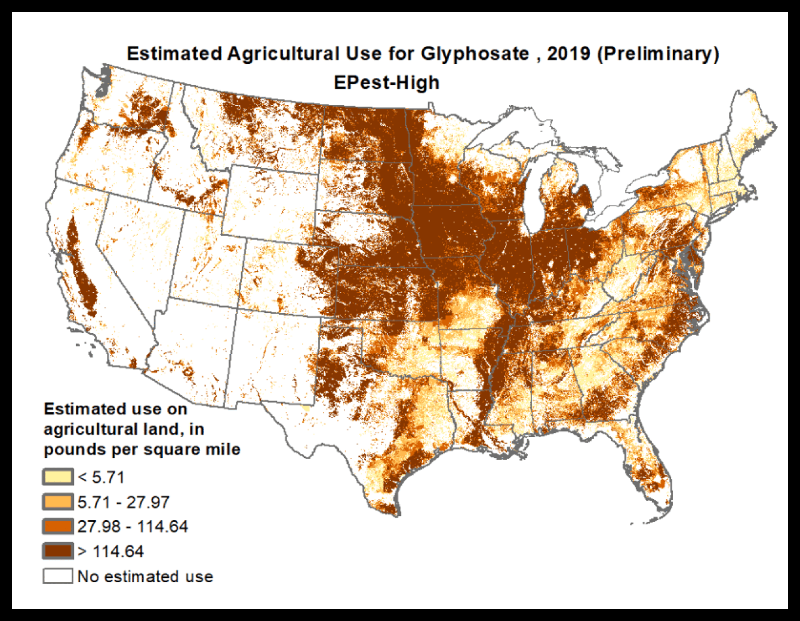

# DATASTUDIES.3250.01 A Historical Event Analysis, 1974–2026 
My submission for DATASTUDIES.3250.01 at Washington University in St. Louis

## How have scientific evidence, legal decisions, and stakeholder interests interacted with regulatory actions to shape U.S. glyphosate regulation over time? 

### Files 
```glyphosate_regulations_plots```
> This folder contains scripts, tables, and plots made from ```glyphosate_regulations.csv```
> ```glyphosate_regulations.csv```
>>  A master historical event dataset, created by compiling information from secondary sources. This includes: the U.S. Environmental Protection Agency (EPA), the International Agency for Research on Cancer (IARC), U.S. court records, the National Academies, Bayer.com, and selected stakeholder and advocacy sources such as U.S. Right to Know (USRTK).

> ```glyphosate_regulations_graphmaker.R```
>> An R script that uses ggplot2 to create three visualizations stored in ```./Plots/```
> ```./Subsets/```
>> This folder contains three subsets of ```glyphosate_regulations.csv```.
>>> ```settlment_data.txt``` contains a timeline of verdict and settlement amounts from glyphosate related law suites.
>>> ```glyphosate_epa_industry_alignment.tsv``` Is a timeline of instances where the EPA discredited or did not align with the evidence presented by independent scientific institutions.
>>> ```glyphosate_epa_exclusions``` contains a timeline of when the EPA chose to uphold evidence brought forth by scientific institutions. 

```US_maps```
> ```maps.csv```
>> A dataset containing citations of images from the National Cancer Institute GIS Portal for Cancer Research. Images regarding demographic specific instances of NHL were fed into a gif, to better visualize comparative regional changes of NHL development in populations separated by race.

```advertisements.csv```
> A dataset containing advertisement image citations regarding glyphosate, which were also created into a gif. These advertisements include local billboards, legal counseling ads paid to appear after specific google searches, traditional television advertisements, and pictures of the physical product on shelves.

```gif_maker.R```
> An R script that reads images from a directory and turns them into a gif using "magick" packages. 



